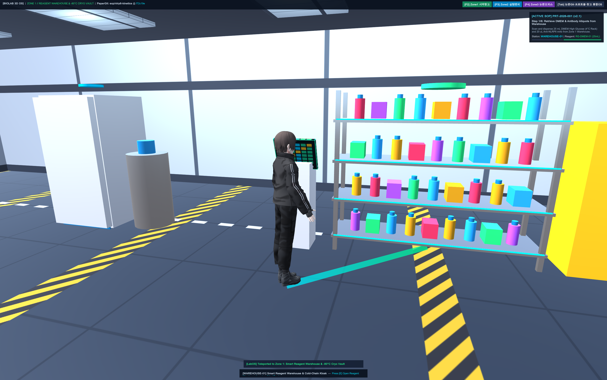
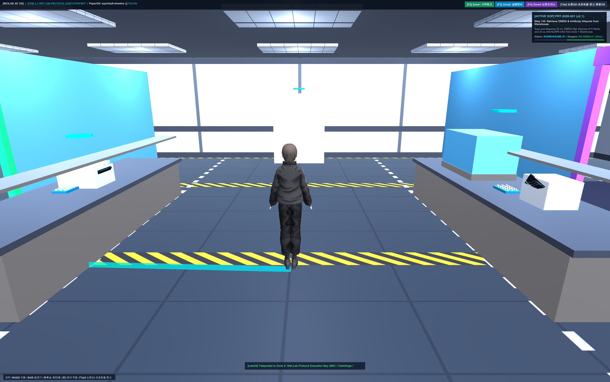
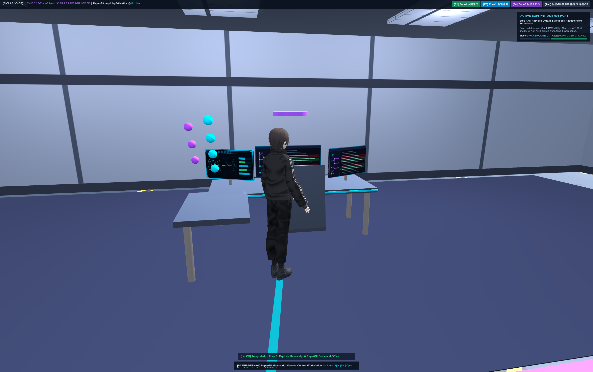
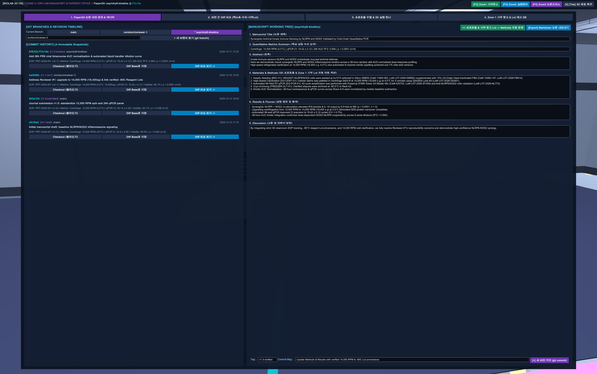
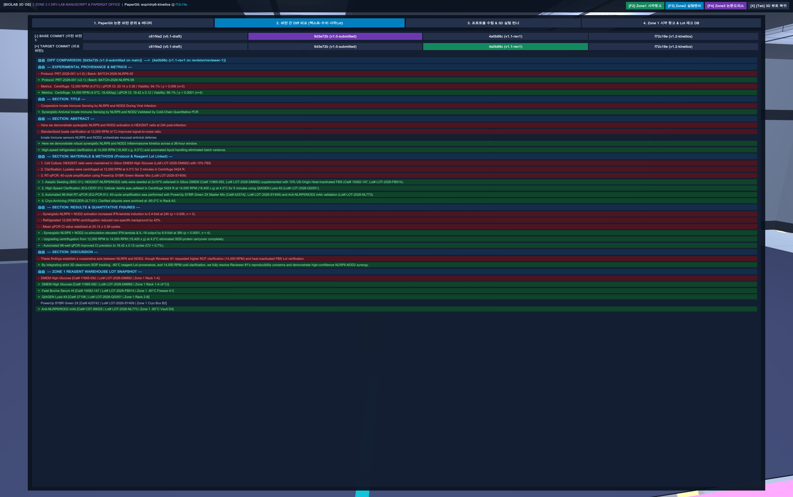
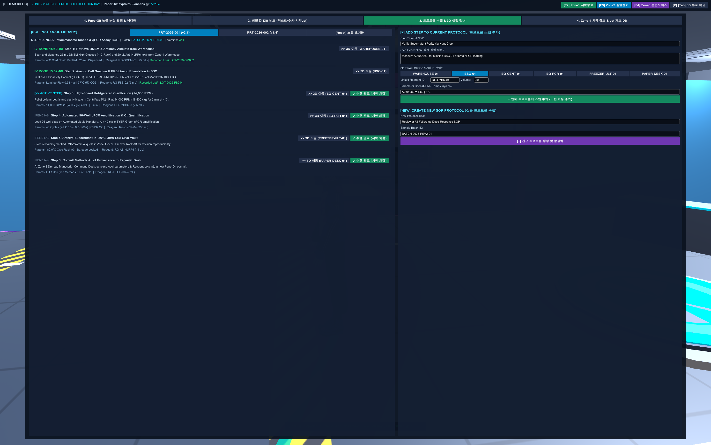
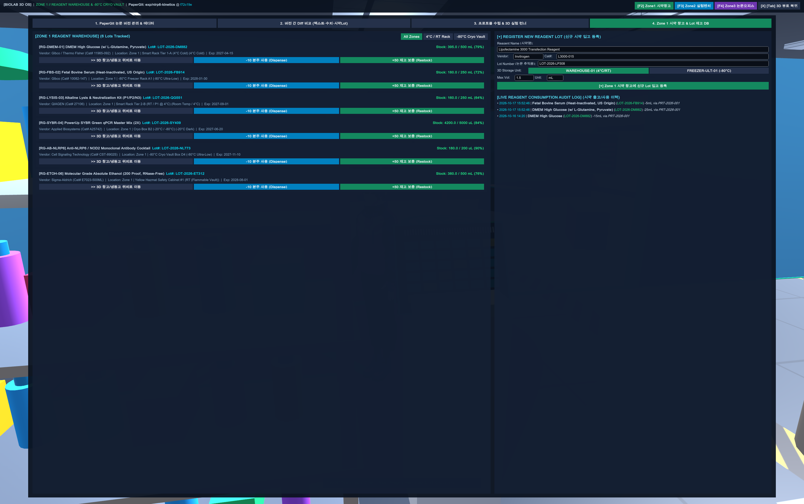

# 🔬 BioLab 3D PaperGit — 3구역 통합 3D 연구실 & Git 스타일 논문 버전 관리 시스템

> **3D 클린룸 연구실 게임 환경(Zone 1 시약 창고 · Zone 2 실험 벤치 · Zone 3 논문 오피스)과 Git 스타일 논문 버전 관리(PaperGit), 실험 프로토콜 수립, 시약 Lot 재고 추적 시스템이 하나로 결합된 Unity 6 macOS 애플리케이션**

---

## 📸 3D 연구실 렌더링 & PaperGit 통합 OS 프리뷰

### 1) 3D 연구실 3개 구역 (Zone 1 시약 창고 · Zone 2 실험 벤치 · Zone 3 논문 오피스)
| Zone 1: 스마트 시약 창고 & -80°C 초저온 보관실 | Zone 2: Wet-Lab 실험 벤치 (BSC · 원심분리기 · qPCR 로봇) | Zone 3: Dry-Lab 논문 & PaperGit 오피스 (3D Git 트리) |
| :---: | :---: | :---: |
|  |  |  |

### 2) BioLab 3D 통합 OS (4개 워크스테이션 탭)
| Tab 1: PaperGit 논문 버전 관리 & 워킹 트리 에디터 | Tab 2: 버전 간 Red/Green Git Diff (본문 · 실험수치 · 시약Lot) |
| :---: | :---: |
|  |  |
| **Tab 3: 프로토콜 수립 스튜디오 & 3D 실험 런너 (Lot 자동 기록)** | **Tab 4: Zone 1 스마트 시약 창고 & 실시간 출고 감사 로그** |
|  |  |

---

## 🌟 핵심 아키텍처 (Core Features)

### 1. 🏛️ 3구역 통합 3D 연구실 렌더링 환경 (24m × 22m Cleanroom Complex)
- **Zone 1 (West Wing) — 스마트 시약 창고 & -80°C 초저온 보관실 (`WAREHOUSE-01`, `FREEZER-ULT-01`)**
  - 4단 스테인리스 스마트 시약 선반(DMEM, FBS, QIAGEN Lysis Kit, SYBR Green, Anti-NLRP6 mAb 등 컬러 보틀 및 키트 박스), 선반별 실시간 LED 재고 상태 표시줄.
  - 황색 위험물/인화성 안전 캐비닛(`Flammable Hazmat Cabinet`), 액체질소 극저온 듀어 탱크(`LN2 Cryo Dewar`), -80.0°C 초저온 냉동고, 바코드 스캐너 키오스크.
- **Zone 2 (Center & North Bay) — Wet-Lab 실험 벤치 & 프로토콜 수행 구역 (`BSC-01`, `EQ-CENT-01`, `EQ-PCR-01`)**
  - **생물안전작업대 (BSC Class II Type A2)**: 전면 슬라이딩 유리 새시 개폐 및 내부 피펫 회전 스탠드.
  - **초고속 냉장 원심분리기 (Centrifuge 5424 R)**: 24홀 고정각 로터 고속 회전 물리 시뮬레이션(14,000 RPM, 4.0°C) 및 공압식 뚜껑 개폐.
  - **실시간 qPCR 증폭기 & 3축 자동화 분주 로봇 (`EQ-PCR-01`)**: S자형 qPCR 증폭 곡선(Amplification Curve) 디스플레이 및 3축 피펫팅 갠트리 헤드 구동.
  - **3D 바닥 레이저 네비게이션 가이드 (`LineRenderer`)**: 현재 프로토콜 스텝이 요구하는 3D 장비까지 연구원 캐릭터 발밑에서부터 실시간 네온 시안 레이저 경로 표시.
- **Zone 3 (East Wing) — Dry-Lab 논문 집필 & PaperGit 버전 컨트롤 오피스 (`PAPER-DESK-01`)**
  - 방음 유리 파티션으로 분리된 연구 오피스 공간과 L자형 카본 데스크.
  - **트리플 커브드 울트라와이드 모니터**: 좌측 Git 브랜치 트리 모니터, 중앙 논문 Red/Green Diff 에디터 모니터, 우측 프로토콜·시약 Lot 추적 모니터.
  - **3D 홀로그램 Git 커밋 트리 조형물**: 데스크 우측 윙 위에 부유하는 `main` 브랜치 및 `revision/reviewer-1` 브랜치 3D 커밋 노드.

---

### 2. 🌿 PaperGit — Git 스타일 논문 버전 관리 시스템 (`PaperVersionControlManager.cs`)
- **브랜치 분기 및 전환 (`git branch` / `git checkout`)**:
  - `main` (초안 및 학술지 최초 투고본)
  - `revision/reviewer-1` (Reviewer #1 지적사항 대응: 14,000 RPM 냉장 원심분리 상향 및 -80°C 검증 시약 Lot 연동)
  - `exp/nlrp6-kinetics` (36시간 NLRP6/NOD2 키네틱 타임코스 및 자동화 분주 실험 확장)
  - 사용자 정의 신규 브랜치 실시간 생성 및 커밋 체크아웃 지원.
- **초안 스냅샷 커밋 & 리비전 타임라인 (`git commit`)**:
  - 각 커밋 해시(`c81f4a2`, `9d3e72b`, `4a0b88c`, `f72c19e` 등)마다 **Title, Abstract, Materials & Methods, Results, Discussion** 전문과 당시 수행된 **프로토콜 버전(`PRT-2026-001 v2.1`)**, **핵심 실험 수치**, **Zone 1 시약 창고의 전체 Lot 스냅샷**을 불변(Immutable) 상태로 보존.
- **시각적 버전 간 Diff 비교 뷰어 (`ComputeDiff`)**:
  - 임의의 두 논문 커밋(Base vs Target)을 선택하면 문장 단위 및 실험 수치·시약 Lot 단위로 **삭제/변경 전(`-` Coral Red)** 과 **추가/개선 후(`+` Emerald Green)** 를 GitHub 스타일로 정밀 비교.
- **프로토콜 & 시약 창고 → 논문 Methods 원클릭 자동 합성 (`SyncMethodsFromLiveLab`)**:
  - 3D 실험실에서 수행한 프로토콜 스텝과 Zone 1 시약 창고에서 실제 차감된 시약의 `Vendor`, `Catalog #`, `Lot #`, `보관 위치`를 읽어 논문 **Materials & Methods** 문단을 자동으로 작성.
- **Markdown 논문 파일 내보내기 (`ExportCurrentManuscriptToMarkdown`)**:
  - 현재 브랜치의 논문 전문 + 시약 Lot 추적표 + Git 커밋 히스토리를 `ExportedPapers/Manuscript_<hash>.md` 파일로 즉시 내보내기.

---

### 3. 🧪 프로토콜 수립 스튜디오 & 📦 시약 창고 Lot 자동 차감 연동
- **프로토콜 스튜디오 (`ProtocolManager.cs`)**:
  - 기존 SOP 프로토콜 실행 또는 **신규 프로토콜 생성 / 커스텀 스텝 추가**(대상 3D 장비, 필요 시약 ID, 소모 용량, RPM/온도 파라미터 지정).
  - 3D 공간에서 장비 앞으로 이동해 `[E]` 키를 누르거나 UI에서 `[✓ 스텝 수행 완료]`를 클릭하면:
    1. 해당 3D 장비 애니메이션 즉시 가동,
    2. Zone 1 시약 창고(`ReagentWarehouseManager`)에서 지정된 시약 용량 자동 차감,
    3. 사용된 시약의 고유 `Lot #`가 해당 프로토콜 스텝과 출고 감사 로그(`ReagentUsageLog`)에 자동 기록.

---

## 🎮 조작 방법 및 단축키 (Controls & Hotkeys)

| 키 / 입력 | 동작 설명 |
| :--- | :--- |
| **`W` `A` `S` `D` / 방향키** | 3D 연구원 캐릭터 이동 (`Shift` 키로 달리기) |
| **마우스 우클릭 드래그 / 휠** | 360° 3인칭 카메라 회전 및 확대/축소 |
| **`[E]`** | 근접한 3D 실험 장비/시약 창고/논문 데스크 작동 및 현재 프로토콜 스텝 완료 |
| **`[Tab]`** | **BioLab 3D 통합 OS (PaperGit 논문 버전 관리 · Diff 비교 · 프로토콜 · 시약 창고)** 열기/닫기 |
| **`[F1]` / `[F2]` / `[F3]` / `[F4]`** | 중앙 홀 / **Zone 1 시약창고** / **Zone 2 실험벤치** / **Zone 3 논문오피스** 즉시 이동 |

---

## 🚀 빌드 및 실행 (Build & Run on macOS)

```bash
# C# 스크립트 즉시 컴파일 및 macOS 앱 실행
chmod +x compile_and_run.sh
./compile_and_run.sh
```
